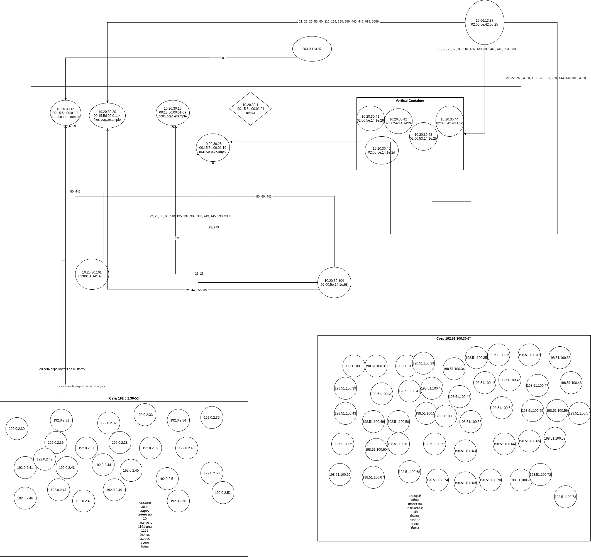

# Отчет по второй лабораторной
| Роль                 | IP адрес                   | MAC адрес                            | DNS-имя             | Порты        | Предположение                                           | Факт                                                                                            |
| -------------------- | -------------------------- | ------------------------------------ | ------------------- | ------------ | ------------------------------------------------------- | ----------------------------------------------------------------------------------------------- |
| Шлюз                 | 10.20.30.1                 | 00:15:5d:00:01:01                    | Нет                 | Нет          | Нет                                                     | Множество ARP-взаимодействий                                                                    |
| Клиенты из подсети   | 10.20.30.101, 10.20.30.104 | 02:00:5e:14:1e:65, 02:00:5e:14:1e:68 | Нет                 | Нет          | Нет                                                     | Нет подозрительных взаимодействий с рабочими станциями                                          |
| Веб-сервер           | 10.20.30.15                | 00:15:5d:00:01:0f                    | portal.corp.example | 80,443       | Нет                                                     | Имеет к себе только обычные HTTP и HTTPS запросы                                                |
| Хранилище            | 10.20.30.20                | 00:15:5d:00:01:14                    | files.corp.example  | 21,445,50000 | Возможно хранилище данных или принтер                   | Имеет к себе только FTP запросы                                                                 |
| Почта                | 10.20.30.25                | 00:15:5d:00:01:19                    | mail.corp.example   | 25, 993      |                                                         | Имеет к себе только SMTP и IMAPS запросы                                                        |
| Контроллер домена    | 10.20.30.10                | 00:15:5d:00:01:0a                    | dc01.corp.example   | 389          | Нет                                                     | Имеет к себе просто LDAP запросы                                                                |
| Рабочие станции      | 10.20.30.41-45             | 02:00:5e:14:1e:{29,2a,2b,2d,2c}      | Нет                 | Нет          | Возможно компьютеры, стоящие в простое                  | Обычные рабочие станции                                                                         |
| Внутренний атакующий | 10.66.13.37                | 02:00:5e:42:0d:25                    | Нет                 | Нет          | Скорее всего, внутренний сканнер портов                 | Сканирует порты серверов и рабочих станций                                                      |
| Внешний brute-force  | 203.0.113.87               | Нет                                  | Нет                 | Нет          | Скорее всего, попытка brute-force подбора пароля админа | Имеется одно рукопожатие, после чего идут 13 вводов разных паролей                              |
| Внешний DDoS (1)     | 192.0.2.30-53              | Нет                                  | Нет                 | Нет          | Скорее всего, массированная DDoS атака                  | Имеется множество одинаковых запросов с одной подсети, при этом пакеты подозрительно одинаковые |
| Внешний DDos (2)     | 192.51.100.30-74           | Нет                                  | Нет                 | Нет          | Точно также, как и в Внешний DDos (1)                   | Точно также, как и в Внешний DDos (1)                                                           |

# Карта сети

